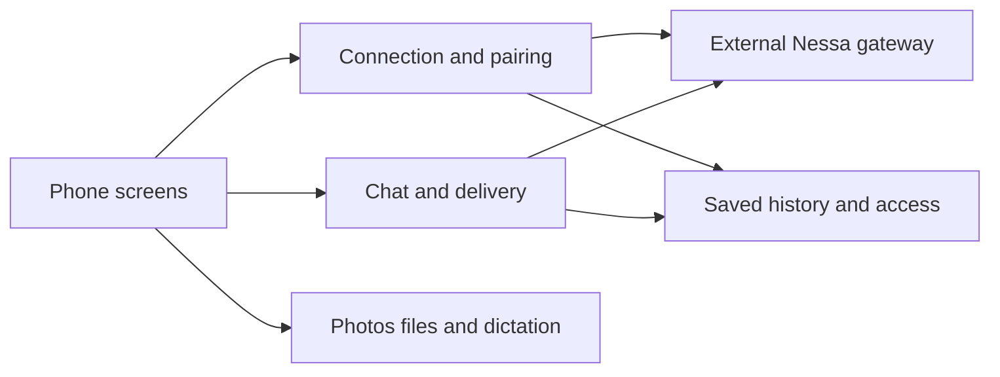

# Nessa on iPhone

Nessa is an iPhone client for conversations hosted by a Nessa gateway. You can
pair with your Mac, open a chat, send text or attachments, see replies and answer
permission requests. The gateway runs the agents; the phone owns its screens,
local drafts and records of requests whose delivery is uncertain.

For example, sending a photo has several steps: prepare it on the phone, upload
its bytes, save the message identity, ask the gateway to send, and display the
reply. Losing the connection after Send does not tell you which remote step
finished. The [delivery guide](services/chat/delivery.md) explains the displayed
outcomes and the supported Retry action.

## Start with a task

| What you want to do                                      | Read next                                             |
| -------------------------------------------------------- | ----------------------------------------------------- |
| Open the app, find an agent or channel, start a chat     | [Screens and navigation](navigation.md)               |
| Pair with a Mac or change connection                     | [Connections](services/connection/README.md)          |
| Send, retry, stop, reply or answer a permission request  | [Chat](services/chat/README.md)                       |
| Archive or delete a conversation                         | [Archive and delete](services/chat/archive-delete.md) |
| Read saved chats while disconnected                      | [History and access](services/history/README.md)      |
| Attach photos/files or dictate text                      | [Media](services/media/README.md)                     |
| Understand what is implemented but absent from normal UI | [Feature inventory](inventory.md)                     |
| See what actually passed and what remains untested       | [Verification](verification.md)                       |

The boxes describe cooperating parts, not a sequence of exclusive states. Open
a phone-owned box for its explanation. The gateway and Apple platform services
are external boundaries; this atlas does not claim to execute or prove them.

## Which app is being described?

The source checkpoint is this repository's exact revision, not the vendored Rust
package's source revision. Debug launches use sample data unless `NESSA_MODE=live`
is set. Release uses live adapters. [Composition and development](development.md)
explains those choices and the native package pin.

Some reusable profile, sharing and deletion APIs exist without being the normal
screen's action. Each relevant page distinguishes those paths. In particular,
the current live product outbox does not use the retained-history readiness gate
that applies to the alternative profile-backed path. A class name or a passing
unit test alone does not establish a reachable screen feature.
