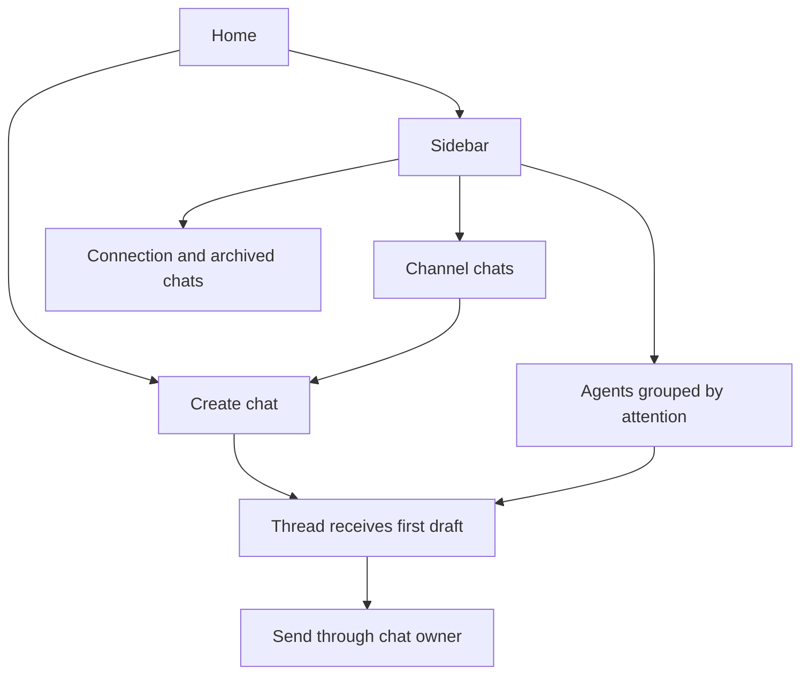

# Find a chat and move between screens

The home screen opens with a greeting and a message field. If a live phone has no
linked desktop and no usable connection, it offers pairing. The sidebar opens
Agents, individual channels, a new chat, and Settings. A channel contains chats;
it is not another gateway connection.

When you send from Home or a channel, the screen first creates a conversation,
then opens its thread and hands the captured text and attachments to that
thread's composer. Creating a chat and sending its first message are separate
operations. An empty created chat can therefore exist even if the later send fails.
The first-message handoff is in-memory navigation state, not a durable outbox.

Agents combines listed chats with known waiting permission reviews. An announcement
can omit an older review, so a previously read waiting review still matters.
Channels place chats with no explicit channel in the default channel. Opening a
row uses the conversation ID; multiple conversations may belong to one agent.
Agent details summarize its identity, available models and associated information;
they do not register a new external provider.

Navigation uses a stack. The sidebar replaces that stack; a back gesture removes
one destination. Changing the delivery scope returns to Home so a thread from
an old connection is not kept as the active destination. Backgrounding the app
asks the connection owner to retire; becoming active asks it to resume under the
saved automatic-connection setting. This is not a promise about OS force-kill.

[Connection](services/connection/session.md) owns network recovery.
[Create and send](services/chat/delivery.md) owns durable request identity.
Navigation and the first-message handoff are source-reviewed here, without a
separate TLA model or an executed UI navigation test.
