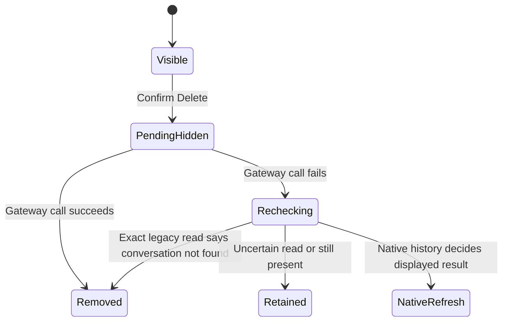

# Archive or delete a chat

From Agents, swipe a chat and confirm Archive or Delete. Archive moves it out of
the normal inbox; Settings → Archived chats lets you open or unarchive it. Delete
asks the gateway to remove the conversation. These are remote operations, not
just local row removal.

Archive changes the displayed archive list only after the gateway call succeeds.
A later incoming message can make the gateway unarchive a chat. Absence from the
normal inbox therefore never proves deletion.

For Delete, an in-memory view-model flag temporarily hides the pending row and blocks stale
preview results. On confirmed success it removes the conversation's local marks,
reply links, cached view and snapshot. If the call fails, it refreshes the list.
On the legacy path it also reads the exact conversation: only a conversation-not-
found response permits cleanup. An uncertain read preserves cached data. The
native-history path refreshes its retained display instead.

Changing connection while deletion runs prevents its old result from changing
the new account's UI. The delete task has an owned lifetime and is drained during
connection retirement; dismissing the screen does not retract an already sent
delete. A failed request may have had a remote effect. There is no normal-screen
restart recovery procedure for uncertain deletion promised by this atlas.

## Separate implemented deletion API

`PhoneConversationDeletion` is a durable intent API with Check and Retry, exact
receipt matching and a single admitted operation. The composition container
constructs it, but `makeMessagesViewModel` does not inject it and the normal swipe
path calls `MessagingService.delete`. Thus its tests do **not** establish that
swipe-delete uses a durable deletion journal. Its standalone behavior is explained
in [durable management APIs](../history/management-apis.md).

The actual view-model, optimistic deletion and standalone deletion tests ran in
the Swift suite. The diagram is source-reviewed; no direct model is claimed for
the normal swipe path or remote erasure.

## A hidden pending row is not deletion proof

The phone hides the row while the delete call is pending and blocks old previews.
The gateway still owns deletion. Dismissing the screen does not retract the
request. Only the current connection generation may apply its result locally.

## A failed delete can still have changed the gateway

The phone rechecks rather than assuming rollback. Inbox absence is insufficient
because archived chats are absent too. The legacy path needs an exact
conversation-not-found read; uncertain reads retain local data. The native path
refreshes retained display. The normal swipe route has no promised durable
Check/Retry flow across app restart.
