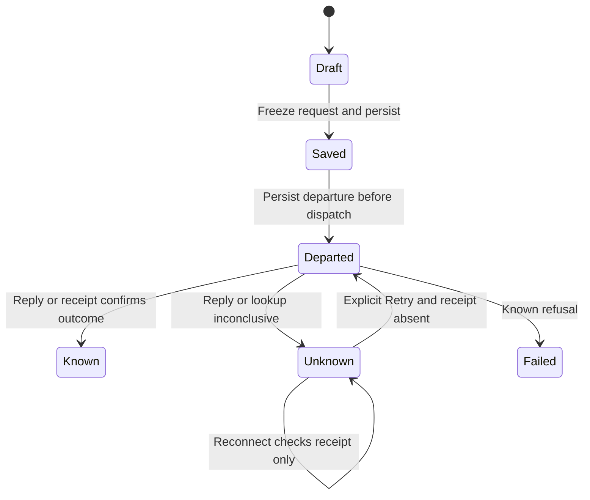

# Send a message and recover uncertain delivery

Suppose you send “Summarize this file” and the connection disappears. The gateway
may have accepted the request even though the phone missed its reply. The live
phone keeps an outbox record: the conversation, request ID, turn ID, text and
uploaded attachment references. Retry uses that exact saved request, not the
current message field. A receipt is the gateway’s saved answer about that exact
request, rather than an inference from what the screen currently shows.

Attachments upload first. After those references are known, the outbox saves the
send and records that it is about to leave before calling the gateway. A failure
before that save prevents dispatch through this owner. A failure after dispatch
may leave an unknown result; it is not proof nothing happened.

The chart isolates durable send ordering. It omits the foreground retry loop and
the replacement draft created after a `turn_running` refusal, explained below.

| What the phone knows                                    | What it means and what you can do                                                                           |
| ------------------------------------------------------- | ----------------------------------------------------------------------------------------------------------- |
| Accepted, running or done                               | Gateway evidence reports the corresponding stage. These are not all the same stage.                         |
| Delivery not confirmed, receipt absent or lookup failed | The row can offer Retry. Retry checks the receipt first and resends the original identity only when absent. |
| Delivery not confirmed, attempt observed or unresolved  | No Retry action is offered by this row. The phone has no reviewed procedure to force a new effect safely.   |
| Message not sent                                        | A known refusal is displayed; revocation also disables automatic connection.                                |

A live send whose outbox result is accepted, running, done **or unknown** is treated
as retained by the view model. The unchanged draft can be cleared in all four
cases. “Delivery not confirmed” is therefore the recovery record, not a promise
that the original text remains in the composer. [Draft ownership](draft.md)
protects text typed after the send began.

Within one foreground attempt, a lost reply permits receipt lookup and at most
three sends in total. An unreadable reply performs lookup without automatic
resend. Restart/reconnect recovery only looks up uncertain records; it never
replays sends. A `turn_running` refusal atomically retains the failed request and
a new unsent successor draft. It does not automatically dispatch that successor.

## When Send becomes available after changing connections

A replacement connection clears the old chat/view collections and returns
navigation to Home. Re-pairing uses a different local cache scope; an old cached
conversation is not permission to address it on the new Mac. Open a conversation
provided by the current connection rather than reusing an old screen identity.

On the normal live outbox route, Send requires a connected current session, no
revocation, no setup operation in progress, no pending-command-load error and no
pending journal submission for that conversation. The composer also waits for
attachment preparation, active dictation and any send already in progress, and needs text or an
attachment to show Send. The view model rechecks current generation, connection
and revocation before dispatch. These local conditions permit an attempt; the
gateway may still refuse the conversation or action.

This route does not wait for the alternative retained-history `commandReady`
predicate. Cached history alone satisfies none of the connected-session checks.

## Scope and evidence

The live composition injects `PhoneProductChat`; this chooses the outbox path.
The [command journal](journal.md) still handles creation and the alternate send
path. Product socket authorization remains with the gateway. Saved-history
readability is not a substitute for connection authority, and the outbox route
is not gated by the alternative native-history `commandReady` predicate.

`OutboxRecovery` models one persisted request, at most two sends, restart lookup
and explicit retry after an absent receipt. It checks persistence before dispatch
and no implicit resend during recovery. It excludes the full outcome grammar,
three-attempt foreground policy, uploads and storage faults. Negative controls
remove the durable-departure guard and permit recovery to resend. Real Swift
outbox/product-chat tests ran in the [425-test baseline](../../verification.md).

## When delivery is not confirmed

The gateway may have acted even though no conclusive reply reached the phone.
The outbox retains the original request, and the unchanged composer can clear.
Reconnect only checks receipts. Use the row's Retry only when offered; it checks
first and repeats the same identity only if the receipt is absent. An attempted
or unresolved result has no forced-retry procedure in this UI.

## What departure means

The phone successfully saved that this exact request may be sent before calling
the gateway. Departure is not gateway acceptance or completion. Attachments may
already have uploaded before this point, so a later error need not mean no effects.
