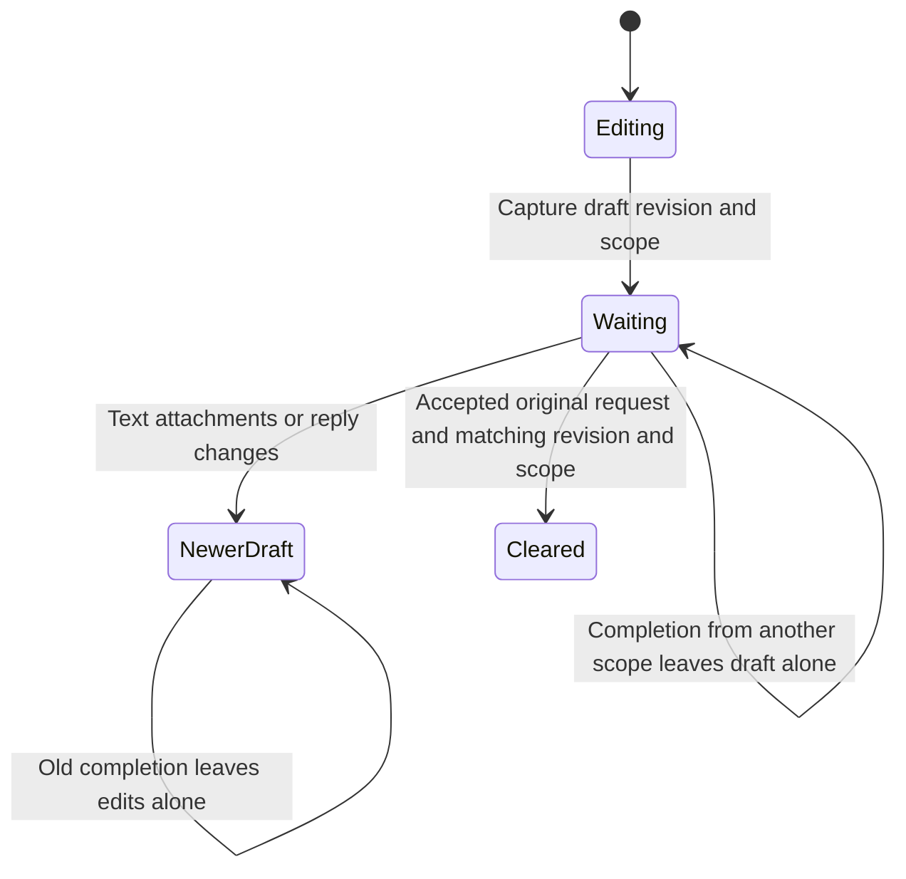

# Keep edits made while a send is finishing

You send one sentence, then type another while waiting. When the first send
finishes, the second sentence must stay. The thread's draft owner captures the
text, attachments, reply, connection scope and revision when Send starts. A
revision is a counter that changes whenever the draft content changes.

Acceptance consumes ownership of that request. It clears text and attachments
only if both captured revision and scope still match. The owner does not clear
the reply field in this method. Its “accepted” signal comes from the caller;
on the [live outbox route](delivery.md), an unknown but retained delivery can
produce that signal. This model does not turn acceptance into remote completion.

Active attempts remain owned while awaiting a result. Pending journal requests
can retain their original ownership for a later acknowledgment. A replacement
connection has a different delivery scope, so an old acknowledgment cannot clear
its draft. This protection is in-memory; it is not draft persistence across
app termination.

`DraftOwnership` explores one request with a later edit and a scope change. It
records what revision/scope a clear actually used. Controls remove each matching
guard independently. The model excludes counter wraparound, multiple outstanding
requests and UI rendering. ComposerDraftTests exercises the actual owner.

## Which draft may be cleared

Only the request’s captured revision and connection scope may clear text and attachments. Acceptance is supplied by the caller, and a retained unknown outbox result can produce it. Clearing does not prove the agent finished.

## A later edit belongs to you

Typing, changing attachments or changing reply increments the draft revision. An earlier completion consumes its own request ownership but leaves these later edits alone. This is in-memory protection, not draft recovery after app termination.
