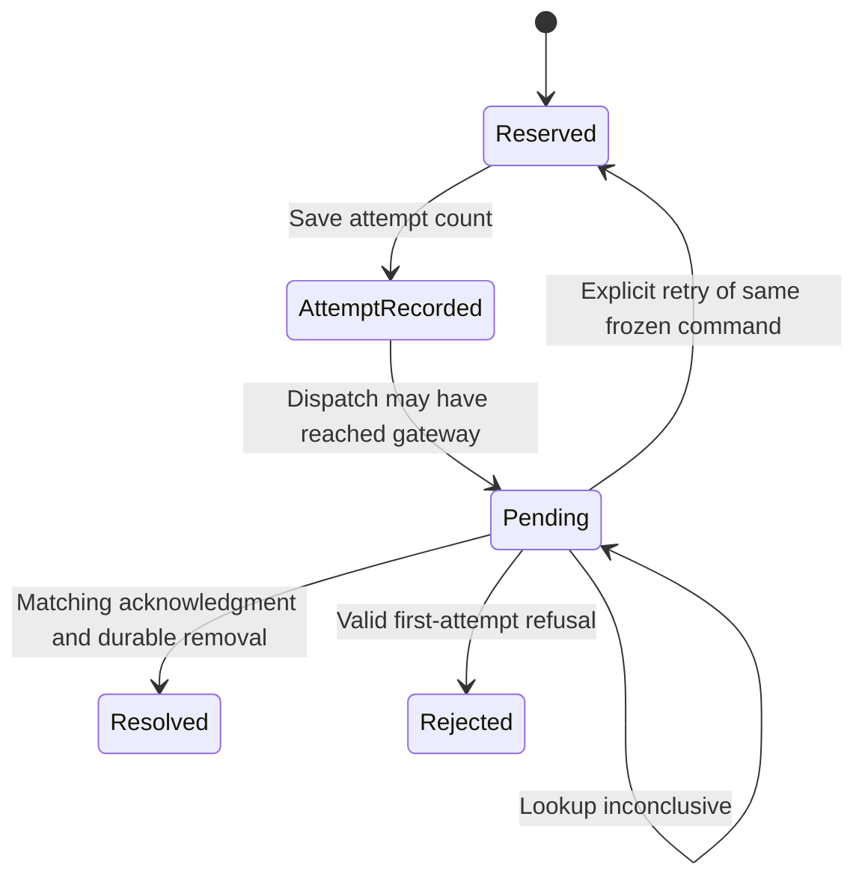

# Check or retry a saved command

A pending chat creation can reappear after reconnect with **Check** and **Retry**.
Check asks whether that exact command completed; it does not create another chat.
Retry checks first, then repeats the saved command only when no confirmation is
returned. Editing the message field does not change this saved command.

The journal saves each intent before dispatch and reserves a slot for it. Product
creation permits one pending creation, and product submission one pending send
per conversation. A journal holds at most 32 commands; uncertain commands are
not evicted to make room. Each connection binding has a lease, meaning an exact
permission to use that journal scope while it is current. A stale lease refuses.

The attempt counter saturates at two, meaning multiple or conservatively unknown
attempts. A known model/photo refusal can release a first attempted command.
A later refusal cannot establish what an earlier uncertain attempt did, so the
pending record remains. A response with another request, turn, conversation or
payload identity cannot resolve this command. Even a valid acknowledgment can
be returned alongside a failure to remove the durable record; the UI preserves
that distinction rather than silently minting another identity.

This owner is wired into live chat creation. Current live sends prefer the
[product outbox](delivery.md); custom/alternate paths can use this journal for
submission. The row's Check/Retry controls are not the same as the outbox row's
conditional Retry button.

`JournalRefusal` models one pending command with attempt count zero, one or two
and independently chosen acknowledgment identity. It checks that only a first
attempt refusal releases the slot, and that acknowledgment resolution matches
the request. Controls remove those two guards. It omits physical file compare-and-
replace, quota, leases and parallel callers; the actual journal tests cover those
separately in the recorded Swift run.

## A later refusal cannot settle an earlier attempt

Only a valid refusal for the first attempted command can release its pending record. A refusal after an earlier uncertain dispatch cannot tell the phone that the earlier effect never happened.

## Use the saved command rather than minting another

Check only looks up the saved request. Retry looks it up first and then repeats its frozen identity if there is no confirmation. The pending slot remains until a matching acknowledgment or permitted first refusal is durably recorded.
