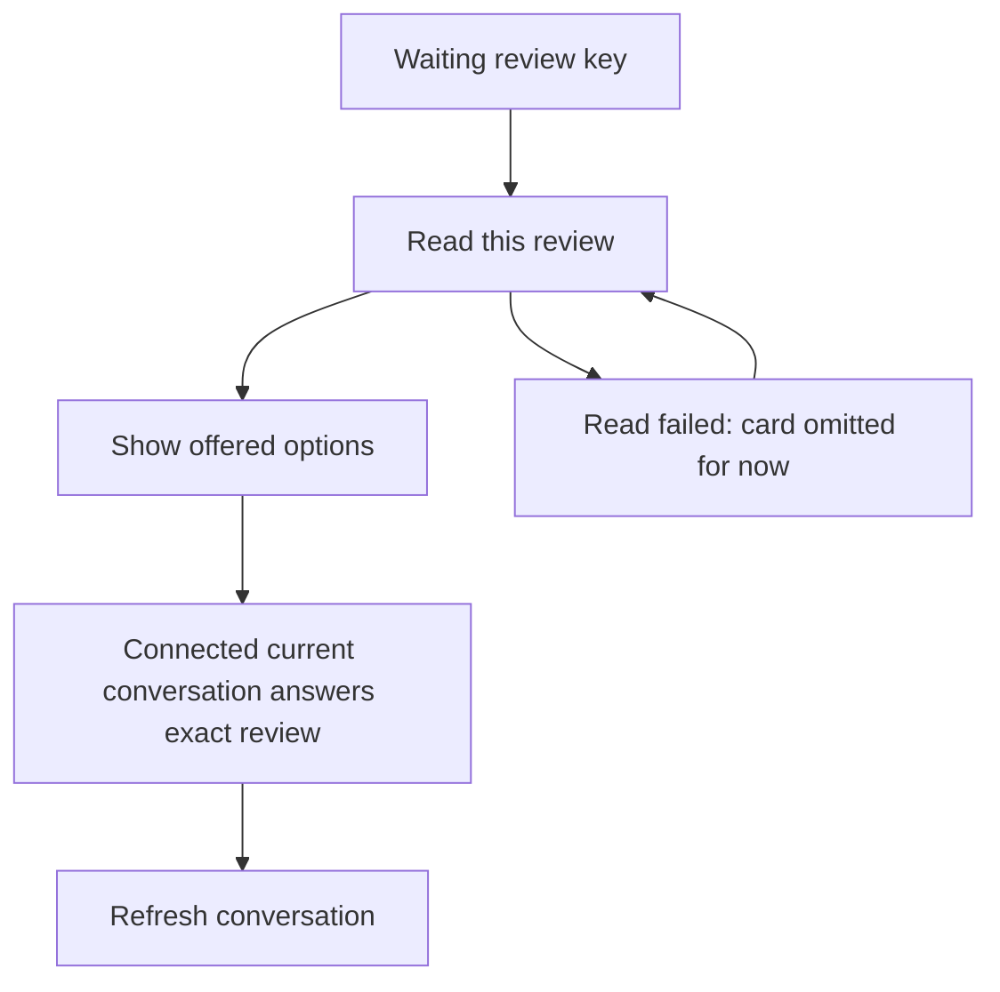

# Answer a waiting permission request

When an agent needs a decision, the phone shows a permission card. Choose one of
the options the gateway supplied. The phone names the exact review in its answer;
it does not invent a broader approval or silently choose an option.

The live announcement lists review keys, not the full question. The application
reads each review's details before showing its card. It caches a successful read
by conversation and review key and shares an in-flight read between callers.
A failed read is retried after five seconds instead of on every incoming frame.
A view that no longer lists a review removes it from the cache.

Agents combines announcement evidence with previously read waiting reviews, since
a bounded announcement can leave older reviews out. An announcement alone is not
proof that all other chats have no waiting decisions. An answer failure is shown;
the phone does not treat the card disappearing locally as remote approval.

This page describes permission reviews. General agent questions are unfinished
product work, not another implemented answer flow. Review caching and waiting
review behavior have Swift tests; there is no separate TLA model on this page.
