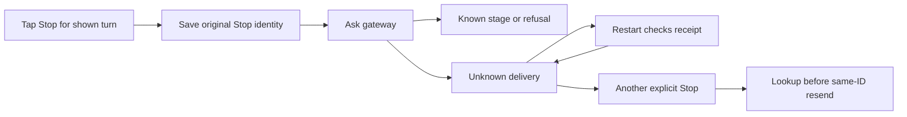

# Ask the current turn to stop

The thread's Stop control targets the turn currently shown as running. It does
not cancel every conversation and does not prove that all provider work has
already ended. The phone asks the product gateway to stop that conversation and
execution ID, then observes the gateway's answer.

Before sending, the live product owner saves a Stop record with a request ID.
If you explicitly stop the same turn again, it looks up that saved request first.
Only an absent receipt permits another send with the same ID. Restart recovery
looks up retryable Stop records and does not resend them.

Accepted, running and done describe gateway receipt stages. Lost/unreadable
responses lead to lookup; an attempted or unresolved result remains uncertain.
A revocation refusal disables automatic connection. The view model does not
publish a separate durable Stop status row or a universal cleanup confirmation.
If the thread still shows running, no local timer proves remote termination.

The flow is source-reviewed, with PhoneProductChat tests in the Swift baseline.
The outbox model's no-replay principle is related, but it does not directly model
Stop's record grammar or provider termination. These are explicit unmodeled
boundaries, not an additional claimed TLA pass.

## Unknown Stop is not verified termination

The gateway may have acted despite a missing reply. Restart looks up this saved Stop and never resends it automatically. Another explicit Stop checks the original receipt and only resends the same request if absent.
