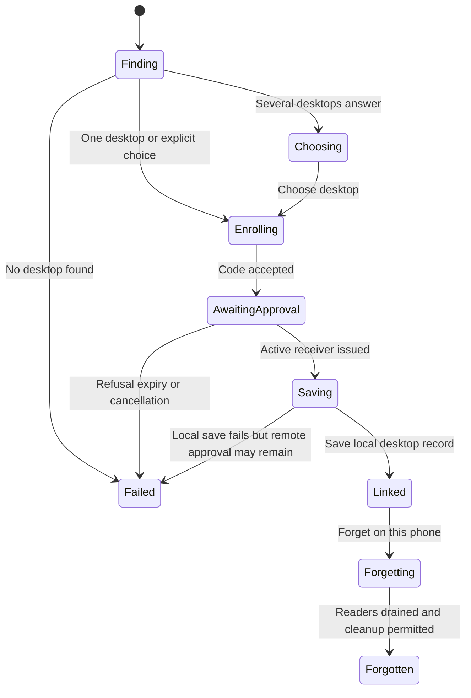

# Pair with a Mac or forget its link

Open Pair with your Mac and scan or type the code displayed by the desktop. The
phone searches the local network. If several desktops answer, choose one. The
code is checked by the gateway, and the desktop owner approves the phone. The
phone does not grant itself access merely because it recognizes a code.

The phone normally searches for three seconds and polls approval every two
seconds, waiting at most fifteen minutes on its own monotonic clock. The desktop
still decides whether its invitation has expired. Wrong, expired, denied and
cancelled invitations are different outcomes; a network failure does not turn
into an approval.

Cancellation observed at the explicit check before loading and saving the local
record prevents that save. Cancellation after that check can still be followed
by a successful save, even if it arrives before the save begins. The view model
retains the returned desktop even if it no longer advances the pairing screen. A native
session that cannot close cleanly can leave its private directory in place rather
than deleting files a worker may still use. A storage error is not proof the
remote approval was revoked.

Forgetting removes the saved local link, blocks new reads and waits for admitted
readers, including the linked product session, to close before deleting their
directory. Failed native close retains that directory. To revoke remote access,
use the desktop's Settings → Linked devices; local Forget is not revocation.
Replacing a Mac blocks old reads immediately and retires its files in background.

A successful product connection may learn an HTTPS tunnel origin from that Mac
and save it for later connections away from its local network. A missing answer
keeps the last address; native pinned identity still decides which desktop can
answer. This is not arbitrary URL trust or guaranteed remote reachability.

`LinkedRetirement` models two possible readers, forgetting and clean/unclean
close. It checks that deletion waits for all readers and never follows an unclean
close. Controls bypass each guard. Network discovery, approval, file durability,
remote revocation and tunnel identity are outside the model. DesktopLinkingTests
and OrbCodeTests ran locally; physical scanning/network qualification did not.

## Forget does not revoke access

Forget removes this phone's saved link and prevents new local reads. Existing
readers and the product connection must drain before local files can be removed;
an unclean native close keeps the directory. Revoke access separately on the
Mac under Settings → Linked devices.

## Pairing failure does not promise remote rollback

A code refusal never grants access, but local cancellation or storage failure
can happen after the Mac approved the phone. Cancellation is observed at explicit
checks; after the final pre-save check the local save may still finish. The phone
must not report that remote authorization was undone merely because its sheet
closed or a local write failed.
