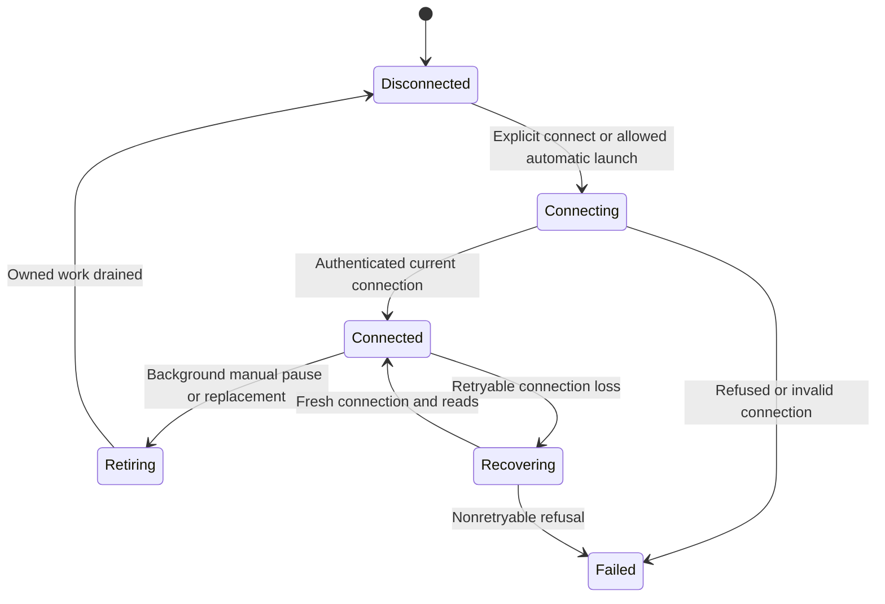

# Pause a connection and reconnect

Settings → Connection shows the current or saved connection. Disconnect saves
that automatic connection is off, then retires the current connection. On the
next launch the phone may show permitted saved content without contacting the
product gateway. Connect is an explicit request to resume. Local disconnect is
not remote revocation, and it does not cancel a gateway effect already sent.

The view model gives each connection attempt a generation number. Results from
an older generation cannot publish into the current screen. The repository also
uses a connection lease tied to the accepted transport. Scope keys include the
address, credential and surface instance; a paired Mac instead uses its pairing
identity for local storage. Re-pairing starts a different local cache scope.

Connection recovery retries only recognized transient network/native-link errors,
with delays starting at 500 ms and capped at 15 seconds. Revocation and settled
pairing refusals stop recovery. It does not replay sends or Stops. Those owners
use [receipt recovery](../chat/delivery.md). Background retirement and manual
replacement await owned setup/read/deletion work before opening a replacement;
observer cancellation alone does not transfer that ownership.

There is no promise that a force-killed iOS process finishes asynchronous drain.
Saved request journals and native files have their own recovery rules. These
connection and generation rules are exercised by Swift tests but are not a
separate TLA proof in this atlas.

## A paused phone does not revoke the gateway credential

Manual Disconnect saves that automatic connection is off. Eligible saved content may remain readable, but the phone cannot send while disconnected. A remote effect already sent is not undone by local retirement.

## Recovery reads state rather than replaying commands

Transient connection errors can be retried with bounded delay. Saved sends and Stops have their own receipt lookups; reconnect does not resend them automatically. Revocation or settled refusal ends automatic recovery.
