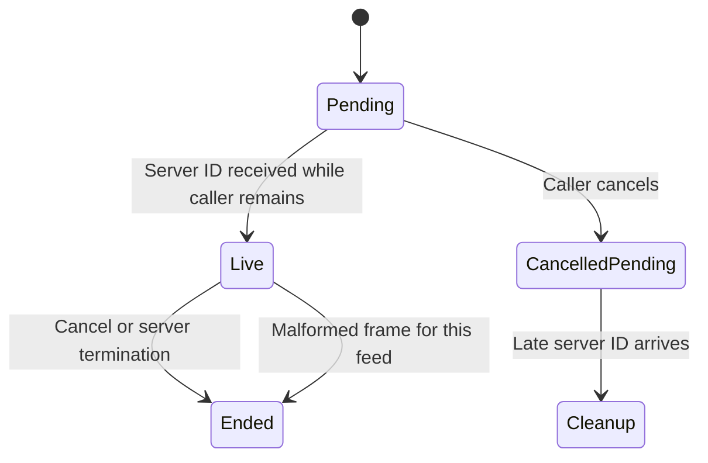

# Follow the inbox and current thread

While connected, the phone follows one inbox and one visible thread. The gateway
sends replacement views rather than a durable replay log for the phone. A slow
screen retains only the newest pending frame per feed, so a missed intermediate
frame is not itself a lost persisted message.

Before sending a subscription request, the socket owner records the caller. It
registers the server's returned ID before resuming that caller. If the caller
cancelled while registration was pending, the late ID is returned for cleanup
instead of becoming a live feed.

Unknown or retired IDs are ignored. A thread frame must name that thread; a list
frame belongs only to the inbox. A malformed publication closes its own feed,
not every other subscription. An ended feed can be lagging, refused, source-closed
or too-large. The application retries lag/source closure with its applied cursor;
it does not retry a refusal as if access had been granted.

A cursor identifies the source incarnation and offset. Older offsets from the
same incarnation are ignored. Applied view cursors are UI observation state,
not the native retained engine's physical replication checkpoint.

`SubscriptionCancellation` models one pending registration, caller cancellation
and late activation. It checks that a cancelled caller is never activated and
that the late server ID is returned for cleanup. Controls remove the cancellation
branch or its cleanup assignment. Capacity two, frame grammar, buffering and
actual socket ordering remain implementation test scope.

## Keep the late registration cleanup path

Cancelling the caller removes its continuation but retains the pending registration. If the server ID arrives later, it is returned for cleanup rather than becoming a live feed.

## An ended feed is not deleted history

The feed can end because of cancellation, lag, source closure, refusal, or a malformed publication. The application retries lag/source closure; refusal is not retried as if authorized. Persisted conversation history is a different owner.
