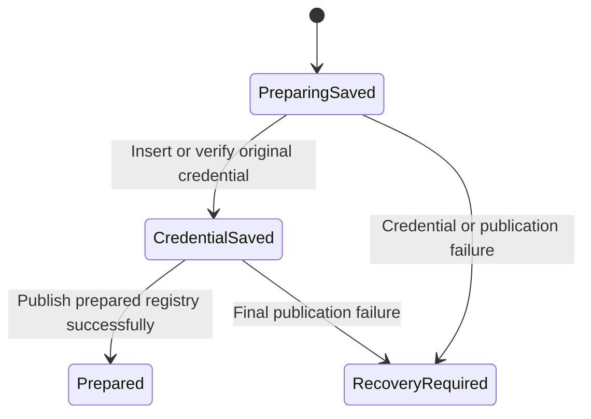

# Prepare and retire a native profile

A native profile binds a gateway/account to private native files and a Keychain
credential reference. Preparing it may fail between writes. The phone keeps a
preparing record so recovery can find the original setup rather than silently
starting another identity.

Preparation first successfully publishes the preparing registry, then inserts or
verifies the credential, then publishes the prepared registry. Seeing the new
bytes after a failed durable write is not enough to continue. A failed final
write can leave a credential and a preparing record, so the error does not mean
nothing changed.

The chart covers preparation only. The coordinator admits one profile operation
at a time and rechecks the selected registry and authenticated account across
awaits. Pairing saves original invitation facts before native enrollment and
requires matching device/receiver evidence before approval. A new account cannot
reuse an old operation's reply. A failed publication marks recovery required.

When native status provides terminal or purge evidence, the coordinator first
publishes that evidence, then suppresses the old display cache, then publishes
retired metadata. Cleanup failure must not erase the evidence that caused
retirement. Close owns both its originally captured native session and one that
finishes opening while close is underway. It waits for admitted work before
releasing ownership.

These profile setup methods are reusable application APIs. The normal pairing
screen uses [DesktopLinking](../connection/pairing.md); technical profile controls
are not presented as normal Settings actions. Existing saved profiles can still
be restored by the app.

`ProfilePreparation` checks one preparation's ordering, including a failed write
whose new bytes are visible but not durably confirmed. Controls permit credential
publication before durable preparation and prepared publication before credential
confirmation. It does not model full pairing, retirement, Keychain behavior or
native close. Their tests ran in the Swift baseline.

## A failed preparation can leave saved facts

The preparing registry or credential may already exist. A write error is not
rollback, and readback of new bytes is not confirmed durability. Recovery must
use the original setup and successfully republish before moving forward. This
is an application API boundary, not an extra button in the normal pairing UI.
