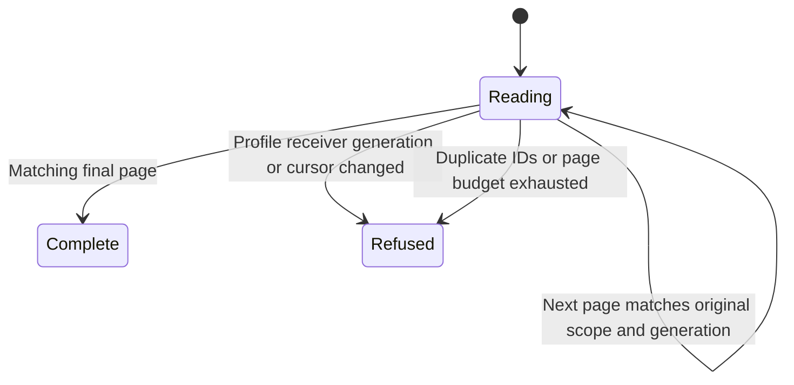

# Read history belonging to the current profile

When the phone opens saved history, it must not combine one account's first page
with another account's later page. A profile identifies the saved native setup;
a receiver identifies the native access that produced its records. The reader
checks those identities and the registry revision on every returned page.

Catalogue reads use at most 200 pages of 50 entries by default. All pages must
agree on receiver, source scope, generation and active boundary/cursor. Duplicate
conversation IDs and repeated pagination cursors refuse the projection. Deleted
entries do not become rows. Reaching the page limit is an incomplete read, not
a complete empty list.

A transcript additionally requires retained/available native content, the requested
conversation ID and the requested UI revision. Failure retains the observations
for diagnostics; it does not manufacture a successful transcript. A retired
profile is not readable through this projection.

## Readable does not mean ready to send

On the alternative profile-backed path, `commandReady` needs a matching current
product connection, a prepared profile, successful fresh refresh/read completion
and positive native status evidence without purge failure. Passive saved-history
reads grant none of that authority. The live product outbox route has different
admission checks, described in [delivery](../chat/delivery.md), and does not use
this predicate as its send gate.

`HistoryCorrelation` models two pages with independently chosen profile,
receiver and generation values. Publication records the actual identities used;
controls remove identity or generation comparison. It excludes native storage,
pagination quotas, active boundary/cursor, access epochs and transcript grammar.
Those exclusions remain implementation checks in PhoneRetainedHistoryTests and
native adapter tests, not implicit model coverage.

## Refused projection does not mean empty history

Mismatched identities, changing generations, duplicate records or a page limit prevent a complete projection. The reader preserves observations for diagnostics rather than inventing a complete empty list.

## A complete read is not command authority

The catalogue pages matched their scope and completed within the budget. This does not establish a current product connection, a fresh native refresh or permission to send. The active product route decides its own admission.
