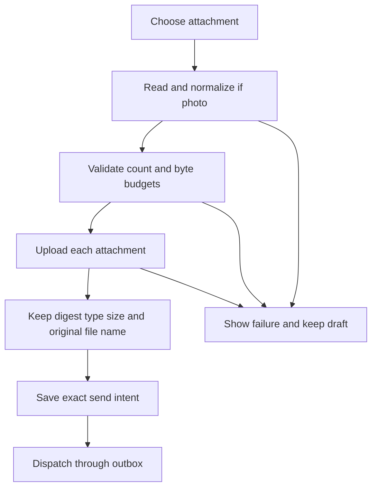

# Prepare and upload a photo or file

Choose a photo or file from the composer. Photos are downsampled off the main
actor and encoded as JPEG before sending. General files retain their original
metadata and bytes. Picking an item does not submit it to an agent.

Live policy permits at most eight attachments, photos up to 5 MiB each and
10 MiB together, and a 64 MiB total message attachment budget. Source photo
loading is separately limited to 64 MiB before conversion. Development policy
has a different image limit, so a sample-mode success is not a live guarantee.
Camera requires available physical camera hardware; Photos uses the system
picker rather than broad library permission. File import uses security-scoped
access while reading.

When no upload address exists, the native/session path begins an upload and
writes pieces of at most 32 KiB. The WebSocket HTTP path uses a single-use upload
ticket for PUT, with cookies, cached credentials and redirects disabled. A refused
piece ends that upload; another Send starts a new upload. The user can be asked
to update the Mac if the upload method is unavailable.

Uploading succeeds before the send record is frozen. A later upload failure or
scope replacement can therefore leave previously uploaded bytes without a
submitted message; there is no all-or-nothing multi-file transaction claimed.
After dispatch, [uncertain delivery](../chat/delivery.md) is a different outcome.
The gateway owns digest verification, placement and actual agent use of files.

New chat model choice prefers the advertised default if it accepts images,
otherwise an advertised image-capable model. Existing chats retain their model.
A photo refusal does not silently change an existing conversation's model.

Swift photo/file/model policy tests ran. Physical picker, real upload endpoint,
remote placement and provider image support were not executed in this pass.
This operation has no direct TLA model; command durability models start after
attachment references exist.

## Uploaded bytes are not yet a submitted message

Earlier attachments may already be uploaded before a later upload or local save fails. The outbox freezes their references only after upload and before dispatch. No all-or-nothing transaction across these stages is claimed.

## Preparation or upload failure keeps this draft

A refusal before outbox submission leaves the draft for correction. It does not prove previously uploaded bytes were rolled back. After a send departs, use the delivery record and its supported Retry action instead.

## Cancel selection or remove a draft item

Cancelling a picker without selecting an item adds no new attachment and does
not clear attachments already in the tray. The camera Cancel delegate dismisses
without an image. A file-picker error is surfaced without clearing the draft;
there is no promise that every platform represents picker cancellation identically.

Before sending, tap an item’s remove control in the draft tray to remove only
that local item. Removal is disabled while sending. Leaving the composer cancels
its current preparation task and prevents a cancelled task from appending a late
item; attachments already appended are not cleared by that cancellation. The
composer’s owning screen can later be destroyed, so this is not a promise to
persist drafts across navigation or app restart.

Removing a draft item is not a remote-delete command. Once Send begins, earlier
uploads may exist even if a later step fails. Dictation cancellation likewise
leaves previously recognized text and the existing attachment tray; only explicit
removal or the matching draft-acceptance path changes those attachments.
