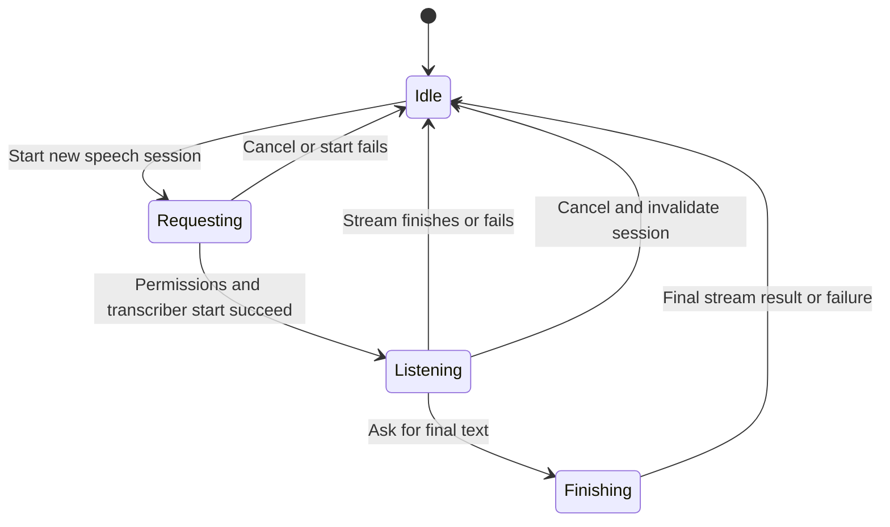

# Dictate text and cancel stale results

Tap the waveform to turn speech into text. Live mode asks for microphone and
speech-recognition permission; development supplies a mock transcript. When
listening, tap again to finish recognition, review the text, then tap Send.
Dictation does not itself submit a chat or send an audio recording.

The same control behaves differently by stage. While permission/start is pending,
tapping it cancels that request. While listening, tapping it asks recognition to
finish and waits for final text; the busy control is disabled while finishing.
There is no separate Cancel button for an active listening stream. Leaving the
composer or moving the app to background cancels recognition. Inactive scene
transitions also cancel except while the permission request is pending.

Each start gets a fresh token, meaning the identity of that speech session.
Callbacks and final cleanup compare their captured token with the current one.
Cancelling rotates it before cancelling the task and transcriber. A late result
from an older session cannot replace the new transcript or reset the new state.
Cancelling does not erase text already recognized: the composer copies each
nonempty transcript update into its draft and leaves that draft when dictation
is cancelled. Leaving the composer or backgrounding the app cancels recognition,
not the text already copied.
A stream ending without a final result is an incomplete-recognition error,
not an invented successful transcript.

`DictationGeneration` explores one old stream and one replacement session. It
checks that accepted transcript updates and cleanup belong to the current token.
Controls remove each comparison. Permissions, Apple callback threading and
physical microphone recognition remain separate implementation/platform concerns.
Dictation and speech-permission callback tests passed locally; no physical speech
recording was performed.

## Stopped recognition leaves recognized text

Cancelling prevents later callbacks from changing the current transcript. It
does not erase text already copied to the message field and does not send it.
Review the draft and tap Send separately. A new speech session ignores the old
session's late callbacks and cleanup.
